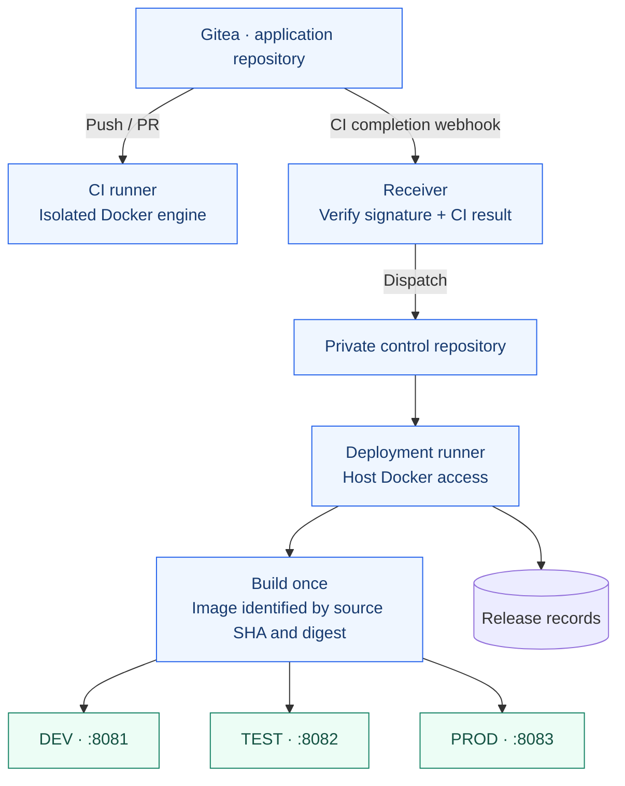
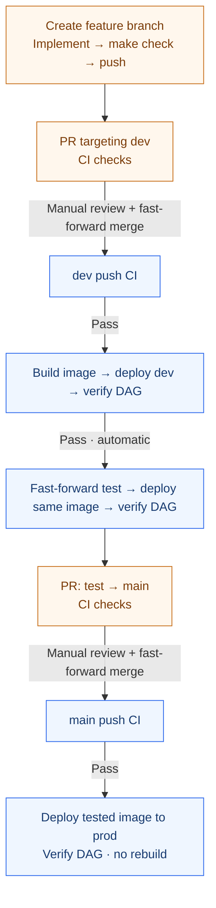

# Airflow CI/CD Lab

A local Apache Airflow project demonstrating automated delivery through **dev →
test → prod** with Gitea Actions and Docker Compose. A sales ETL pipeline provides
the workload; the same application image is promoted across all environments.

## Requirements

- Linux or WSL2 with Git and Make
- Python 3.11+ for development (tested with 3.14)
- Docker Engine or Docker Desktop with Docker Compose

Airflow runs in containers using Airflow 3.3.2 and Python 3.12.

## Installation

```bash
git clone https://github.com/Amoladhav/airflow-best-practices.git
```

```bash
cd airflow-best-practices
```

```bash
python3 -m venv .venv
```

```bash
source .venv/bin/activate
```

```bash
python3 -m pip install -e '.[dev]'
```

```bash
python3 -m pre_commit install
```

```bash
make check
```

## Local platform setup

Start Gitea and create its first administrator (existing accounts are preserved):

```bash
make platform-bootstrap
```

First-time setup also requires Airflow environment files, secrets and input data, plus
local Gitea application/control repositories and registered CI/deployment runners.
See the [runtime guide](docs/airflow-runtime.md) and
[CI/CD setup guide](docs/local-cicd.md) for prerequisites and configuration.

Once those prerequisites are ready, save a Gitea API token through the hidden prompt:

```bash
python3 infra/cicd/setup.py credentials
```

Start the platform and publish its deployment controller:

```bash
make platform-start
```

```bash
make platform-install
```

| Service | URL | Git branch |
|---|---|---|
| Gitea | http://localhost:3000 | — |
| Airflow dev | http://localhost:8081 | `dev` |
| Airflow test | http://localhost:8082 | `test` |
| Airflow prod | http://localhost:8083 | `main` |

Airflow endpoints become available after their environments are deployed.

## Airflow login and secrets

Use username `admin`. Retrieve the selected environment's password locally:

```bash
make airflow-password ENV=prod
```

Choose `dev`, `test` or `prod`. Passwords can change when API containers are
recreated. Keep credentials out of Git and shared logs; see
[secret management](docs/secrets.md) and [first-time Gitea setup](docs/local-cicd.md).

## Usage

| Task | Command |
|---|---|
| List commands | `make help` |
| Run lint, format checks and tests | `make check` |
| Format Python | `make format` |
| Inspect prod containers | `make status ENV=prod` |
| Open prod PostgreSQL SQL prompt | `make db-connect ENV=prod` |
| Read prod sales data | `make sales ENV=prod` |
| Follow scheduler logs | `make logs ENV=dev` |
| Inspect release records | `make releases` |
| Stop CI services; leave Airflow running | `make platform-stop` |

## Architecture



Each environment has its own input files, PostgreSQL metadata, SQLite sales data
and logs. Application CI has no host Docker socket or deployment credentials.

## Development lifecycle



Failed checks stop progression. `main` is the production branch; there is no
separate `prod` branch. The `sales_etl` DAG validates CSV records, upserts sales
into SQLite and verifies the stored rows.

## Documentation

- [Architecture and detailed lifecycle](docs/architecture.md)
- [Commands and advanced operations](docs/commands.md)
- [Setup, release verification and recovery](docs/local-cicd.md)
- [Airflow runtime](docs/airflow-runtime.md)
- [Quality gates](docs/quality-gates.md)
- [Credentials and Airflow login](docs/secrets.md)

This is a local learning environment. Keep credentials and runtime data out of Git.
