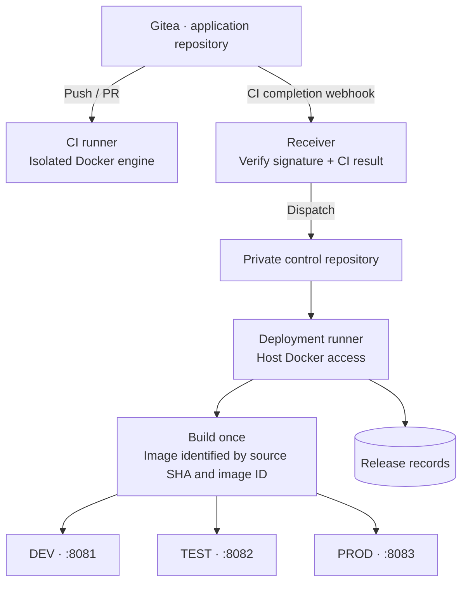
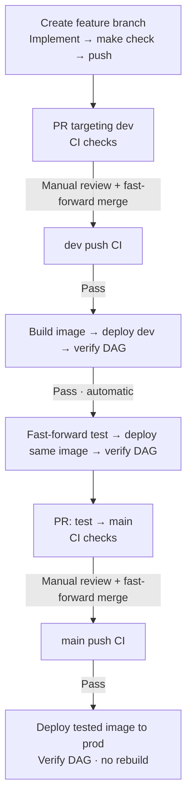

# Airflow CI/CD Lab

A local Apache Airflow project demonstrating automated delivery through **dev →
test → prod** with Gitea Actions and Docker Compose. A sales ETL pipeline provides
the workload; the same application image is promoted across all environments.

## Requirements

- Linux or WSL2 with Git and Make
- Python 3.11+ for development (tested with 3.14)
- Docker Engine or Docker Desktop with Docker Compose

Airflow runs in containers using Airflow 3.3.2 and Python 3.12.

## Quick start

With Docker running, clone the repository and enter it:

```bash
git clone https://github.com/Amoladhav/airflow-best-practices.git
```

```bash
cd airflow-best-practices
```

Run setup and enter the administrator username and email:

```bash
make setup
```

Setup generates credentials locally, creates Gitea repositories and runners,
installs the deployment controller and webhook, and verifies the initial release
in dev, test and prod. No token copying or browser configuration is required.
Progress includes elapsed times, CI/deployment links and regular waiting updates.
Detailed output is saved under `logs/setup/`; credential output is excluded.
The generated Gitea login is saved in `secrets/gitea-admin-login.txt`; change its
password after signing in. Downloads and deployment checks can take several minutes.

Rerun the same command to resume an interrupted setup. Existing credentials and
input data are preserved. See [setup and troubleshooting](docs/local-cicd.md).
An existing manually configured installation continues to use `make platform-start`;
setup refuses to adopt it without its own saved state.

| Service | URL | Git branch |
|---|---|---|
| Gitea | http://localhost:3000 | — |
| Airflow dev | http://localhost:8081 | `dev` |
| Airflow test | http://localhost:8082 | `test` |
| Airflow prod | http://localhost:8083 | `main` |

Airflow endpoints become available after their environments are deployed. The UI
identifies DEV in blue, TEST in amber and PROD in red.

## Airflow login and secrets

Use username `admin`. Retrieve the selected environment's password locally:

```bash
make airflow-password ENV=prod
```

Choose `dev`, `test` or `prod`. Passwords can change when API containers are
recreated. Keep credentials out of Git and shared logs; see
[secret management](docs/secrets.md) and [first-time Gitea setup](docs/local-cicd.md).

## Development tools

Setup needs Python's standard library only. Install local development tools separately:

```bash
python3 -m venv .venv
```

```bash
source .venv/bin/activate
```

```bash
python3 -m pip install -e '.[dev]'
```

```bash
python3 -m pre_commit install
```

## Usage

| Task | Command |
|---|---|
| List commands | `make help` |
| Run lint, format checks and tests | `make check` |
| Format Python | `make format` |
| Inspect prod containers | `make status ENV=prod` |
| Open prod PostgreSQL SQL prompt | `make db-connect ENV=prod` |
| Read prod sales data | `make sales ENV=prod` |
| Follow scheduler logs | `make logs ENV=dev` |
| Apply API/UI settings using the deployed image | `make ui-apply ENV=test` |
| Inspect release records | `make releases` |
| Stop CI services; leave Airflow running | `make platform-stop` |

## Architecture



Each environment has its own input files, PostgreSQL metadata, SQLite sales data
and logs. Application CI has no host Docker socket or deployment credentials.

## Development lifecycle



Failed checks stop progression. `main` is the production branch; there is no
separate `prod` branch. The `sales_etl` DAG validates CSV records, upserts sales
into SQLite and verifies the stored rows.

## Repository layout

| Path | Contents |
|---|---|
| `dags/`, `src/`, `tests/` | Pipeline, application code and tests |
| `infra/docker/` | Dockerfiles, Compose files and runner configuration |
| `infra/cicd/`, `infra/gitea/` | Platform setup, webhook receiver and deployment controller |
| `environments/` | Public environment settings |
| `secrets/` | Local credentials; ignored by Git |
| `make/`, `scripts/` | Developer commands and runtime utilities |
| `docs/` | Setup and operating guides |

## Documentation

- [Architecture and detailed lifecycle](docs/architecture.md)
- [Commands and advanced operations](docs/commands.md)
- [Setup, release verification and recovery](docs/local-cicd.md)
- [Airflow runtime](docs/airflow-runtime.md)
- [Quality gates](docs/quality-gates.md)
- [Credentials and Airflow login](docs/secrets.md)

This is a local learning environment. Keep credentials and runtime data out of Git.
