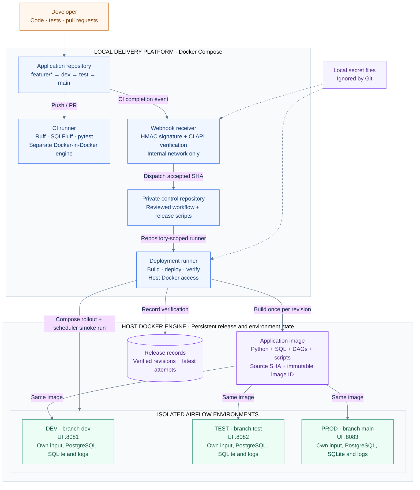

# Architecture and development lifecycle

A local delivery platform that promotes one application image through three
isolated Airflow environments. **`main` is the production branch; `prod` is the
environment name.** GitHub is a publication destination, not the active CI engine.

## Platform architecture



The app CI runner cannot access the host Docker socket or deployment credentials.
The trusted runner can manage the three environments. Its registration is scoped
to the private control repository. Templates live in this codebase under
`infra/gitea/deply-repo/`; `make platform-install` publishes them to the control
repository. Private API credentials stay in locally mounted secret files.

Each environment runs an API server, scheduler with LocalExecutor, DAG processor,
and PostgreSQL metadata service. Initialization containers migrate metadata and
prepare volume permissions. SQLite contains **business sales data**; PostgreSQL
contains **Airflow run/task metadata**. CSV inputs and state are never promoted
with the image.

## Developer and release lifecycle

```mermaid
%%{init: {'theme': 'base', 'themeVariables': {'fontFamily': 'Inter, Arial, sans-serif', 'primaryTextColor': '#172B4D', 'lineColor': '#60758A', 'actorBkg': '#EFF6FF', 'actorBorder': '#2563EB', 'noteBkgColor': '#FFF7ED', 'noteBorderColor': '#C56A13'}}}%%
sequenceDiagram
    autonumber
    actor Developer
    participant Git as Gitea branches / PRs
    participant CI as Application CI
    participant CD as Receiver + deployment workflow
    participant Runtime as Airflow dev / test / prod

    Developer->>Developer: Feature branch · implement · make check
    Developer->>Git: Push feature and open PR targeting dev
    Git->>CI: Run feature / PR checks
    CI-->>Git: Pass or fail
    Note over Developer,Git: MANUAL GATE 1 · review and fast-forward merge into dev
    Developer->>Git: Merge approved PR into dev
    Git->>CI: Run push CI for exact dev SHA
    CI-->>Git: Successful completion
    Git->>CD: Signed workflow_run webhook
    CD->>Git: Verify CI result, workflow, branch and current SHA
    CD->>CD: Build or reuse image; record immutable image ID
    CD->>Runtime: Deploy DEV; verify image and sales_etl run
    Runtime-->>CD: Dev verified
    CD->>Git: Fast-forward test branch to the same SHA
    Git->>CI: Test push checks (additional CI)
    CD->>Runtime: Deploy SAME image to TEST; verify sales_etl
    Runtime-->>CD: Test verified; retain release record

    Note over Developer,Git: MANUAL GATE 2 · test → main PR, CI and fast-forward merge
    Developer->>Git: Merge approved test PR into main
    Git->>CI: Run push CI for exact main SHA
    CI-->>Git: Successful completion
    Git->>CD: Signed workflow_run webhook
    CD->>CD: Require matching verified test release; NO rebuild
    CD->>Runtime: Deploy recorded image to PROD; verify sales_etl
    Runtime-->>CD: Prod verified; record image, SHA and run ID
    Developer->>Runtime: Inspect UI, make sales ENV=prod, make releases
```

**Failure handling:** failed CI does not dispatch. Failed dev verification prevents
promotion to test. Failed test verification prevents prod eligibility, even though
the test branch has already advanced. A failed prod attempt remains visible
separately from the last verified release. Runtime rollback is a manual control
workflow action selecting a previously verified prod image; it does not undo data
or move Git branches. See [recovery details](local-cicd.md#records-and-recovery).

Opening a PR runs CI; it does not deploy prod. Only successful **push CI on `main`**
after the owner's merge starts normal production deployment. No `prod` Git branch
is needed. Automated test promotion does not require a manual dev → test PR.

## Daily developer workflow

| When | Developer action | Automation / verification |
|---|---|---|
| Start a session | `make platform-start` | Starts CI services and resumes webhook |
| Before committing | `make check` | Lint, formatting check, unit/integration tests |
| Submit a change | Push feature; PR with **base dev** | Feature/PR CI |
| Accept development | Manually fast-forward merge into dev | Dev CI → dev deployment → test promotion/deployment |
| Inspect release | `make releases`; dev/test Airflow UI | Compare revision, image and latest attempt |
| Accept production | PR with **base main**, compare test; manually merge | Main CI → retained image deployment to prod |
| Inspect sales | `make sales ENV=prod` | Read-only SQLite rows from running prod container |
| End a session | `make platform-stop` | Checks jobs and disables webhook; Airflow remains running |
