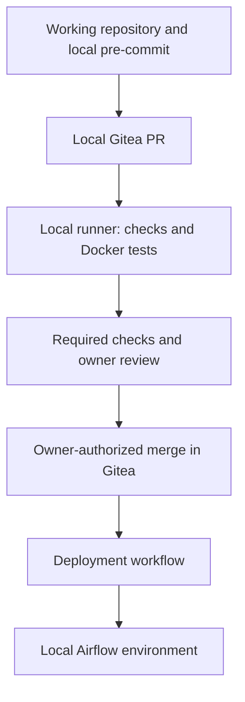
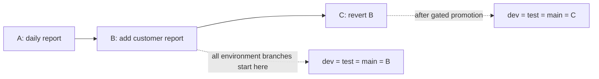
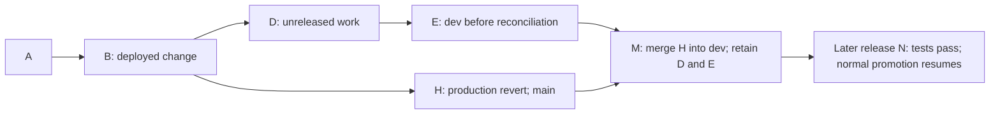
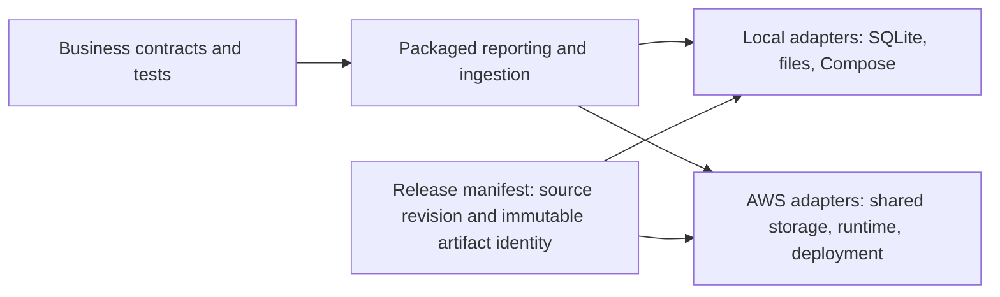

# Functional changes, promotion and code backout

Status: three functional CRs accepted in scope; detailed delivery design documented. The
reports, deployment controls and backout exercises below are not implemented or
runtime-verified. Commit letters and release names are illustrative, not repository
SHAs. Existing sales ingestion, validation, transactional loading and runtime/data
isolation remain the foundation.

## Selected platform and CI session lifecycle

The local phase uses **Gitea + a Gitea Actions runner + Docker**, with local
Airflow dev/test/prod. Gitea provides repository hosting, PRs, review and branch
rules; the runner executes jobs; the owner authorizes merges; a post-merge workflow
deploys accepted code. CI services are separate from Airflow. No platform services
or runners have been installed yet.



GitHub Actions is reserved for the AWS phase. Shared tests and release contracts
remain reusable; workflow compatibility and cloud adapters require validation.
Local hosting does not imply offline operation: tool, action and image downloads
may require internet access. See [Gitea Actions](https://docs.gitea.com/usage/actions/overview/)
and its [runner documentation](https://docs.gitea.com/runner/).

Before platform setup, verify pinned server/runner compatibility, PR checks and
merge/protection behavior, and a CI/CD access boundary. Untrusted PR jobs must not
receive deployment credentials, business data or unrestricted deployment-host
Docker access. Existing diagrams illustrate ancestry; selecting Gitea does not
by itself enforce the same-SHA/fast-forward promotion policy. Resolve that policy
explicitly before implementing promotion.

CI execution is session-scoped. Start the platform and dedicated runner explicitly,
perform the exercise, then shut them down. No automatic startup/restart, scheduled
workflows or hosted-compute fallback. Set job timeouts and deployment concurrency.

Shutdown acceptance, including failed or interrupted exercises:

1. Prevent new lab jobs with the supported Gitea workflow controls.
2. Finish/cancel queued and running jobs; inspect interrupted deployments.
3. Stop the dedicated runner and disposable CI job containers; verify runner status
   and that no jobs remain pending while Gitea is still available.
4. Stop the lab Gitea services and verify all dedicated CI processes/containers are
   stopped. Preserve repository/database/configuration volumes and release artifacts.

Provide owner-run session start/stop/status operations and a fallback; a final
workflow step alone cannot guarantee shutdown of its executor. Do not stop unrelated
Airflow services or delete data/volumes. Preserve this lifecycle requirement when
moving to GitHub Actions/AWS, with platform-specific cancellation and billing checks.

## Objective and exercise boundaries

Deliver useful sales reports through a repeatable CI/CD process, then demonstrate
that an operator can withdraw a release, restore a known-good artifact and reconcile
source branches without losing shared Git history.

Use three functional change requests. Two would demonstrate promotion and backout;
the third demonstrates that normal delivery resumes successfully afterward. Do not
create more features simply to exercise the pipeline.

For the incident drill, declare that a deployed release must be withdrawn. No real
data corruption, deliberately weakened tests, database schema change or data restore
is required. All reporting reads sales without modifying them. Preserve existing
dev/test/prod input and output, including the intentionally different test fixture.
Hypothetical acceptance rows below belong in isolated test fixtures.

## Functional change requests

### Common reporting contract

- Report the current persisted sales state, including rows retained from earlier
  batches. Reports are not restricted to the latest input CSV and do not reconstruct
  past versions of a sale.
- Counts mean sale records. Totals use integer cents in the dataset's existing
  single monetary unit; mixed currencies and exchange conversion are out of scope.
- Return deterministic ordering and exact totals. Zero-value sales count as sales.
  Empty results contain an empty rows list. Do not silently truncate large totals.
- Keep reporting logic outside Airflow. Use one packaged reporting entry point and
  a thin, manually triggered `sales_report` DAG with a stable `generate_report` task.
  The existing ingestion DAG remains unchanged. Reports require completed ingestion;
  the exercise does not run a report concurrently with a load.
- Produce a small JSON artifact at a configured output location. Publish a complete
  result, not an append to a previous report. A repeat of the same request against
  unchanged sales produces the same business rows. Local publication can use a
  temporary file and replacement; cloud publication must implement its own contract.
- Identify the report type, request parameters and execution/release provenance
  separately from business rows. Each run has its own artifact location. Retries of
  that run replace its result safely; partial results must not appear successful.
- Keep the output layout backward-compatible across these CRs. Pass an artifact
  reference through XCom, not the report data. Do not add summary database tables,
  a web service or a dashboard to this increment.

### Example acceptance dataset

These four synthetic rows are a proposed test fixture, not a replacement for runtime
data. A sale_date is a calendar date; no timestamp or timezone conversion is implied.

| sale_id | sale_date | customer_id | amount_cents |
|---|---|---|---:|
| 1 | 2026-10-01 | C001 | 1995 |
| 2 | 2026-10-01 | C002 | 1000 |
| 3 | 2026-10-02 | C001 | 500 |
| 4 | 2026-10-02 | C003 | 0 |

### CR-1: Daily sales totals

Business question: how many sales occurred on each date, and what was their value?

Request `report_type=daily`. Output fields are sale_date, sale_count and
total_amount_cents, ordered by sale_date ascending. Expected rows:

| sale_date | sale_count | total_amount_cents |
|---|---:|---:|
| 2026-10-01 | 2 | 2995 |
| 2026-10-02 | 2 | 500 |

Acceptance: assert exact rows; empty-store behavior; zero-valued sales; deterministic
replay; unchanged base sales. Updating sale 1 to 2095 in an isolated test should
change the first total to 3095 without changing its count. This is the first normal
feature promotion and establishes the known-good release for the backout drill.

### CR-2: Customer sales totals

Business question: how many sales and how much value does each customer contribute?

Add `report_type=customer`, preserving daily mode as the default. Output fields are
customer_id, sale_count and total_amount_cents, ordered by customer_id ascending.
Expected rows:

| customer_id | sale_count | total_amount_cents |
|---|---:|---:|
| C001 | 2 | 2495 |
| C002 | 1 | 1000 |
| C003 | 1 | 0 |

Acceptance: combine one customer's sales across dates; keep distinct customers
separate; preserve zero-value customers; reject unsupported report types; keep all
CR-1 tests passing and base sales unchanged. Promote this release normally, then
declare it withdrawn for the exercise. Falling back to CR-1 deliberately withdraws
customer reporting; daily reporting must remain available. This capability loss is
an explicit incident decision, not a claim of transparent backward compatibility.

### CR-3: Date-range reporting

Business question: produce daily or customer totals for a specified reporting period.

Add optional start_date and end_date with the interval **start inclusive, end
exclusive**. Both must be present or both absent; absence preserves all-history
behavior. Require valid ISO dates and start_date < end_date. Filter by sale_date
before grouping, using bound parameters for storage queries.

For [2026-10-01, 2026-10-02), daily mode returns only (2026-10-01, 2, 2995).
Customer mode returns (C001, 1, 1995) and (C002, 1, 1000). The next day's sales are
excluded. A valid interval without sales returns no rows. Invalid requests fail
without publishing a new successful artifact. Keep existing modes and base sales
unchanged. Introduce this CR after the customer capability has been explicitly
reintroduced through a new reviewed change following the drill.

Currency support and schema evolution are deferred. They introduce compatibility
and data-migration decisions that are unnecessary for these delivery exercises.

## Where the CRs exercise CI/CD

| Delivery milestone | Functional evidence |
|---|---|
| Local hooks and incoming-revision CI | A temporary CR-1 implementation defect is caught by its expected-row tests; correct it before acceptance |
| First controlled deployment | Promote CR-1, run the report in each environment, verify its own expected data and artifact identity |
| Repeatable promotion | Promote CR-2 using the same gates and release mechanism |
| Code backout and source reconciliation | Withdraw CR-2, restore the CR-1 artifact, promote a revert and verify branch/runtime identities |
| Resume normal delivery | Reintroduce CR-2 in a new reviewed change, then deliver CR-3 and its boundary tests |

Do not compare dev/test/prod report values as if their data were identical: test's
sale 1 intentionally differs. Assert each environment's result against its input
and persisted state. A report task succeeding is not sufficient; inspect its output.
A feature commit can exist locally and on Gitea while failed PR checks block its
merge into an environment branch.

## Quality hooks and command interface

The following scope is agreed; implementation is pending except where noted.
The release exercises use these gates rather than a second set of validation rules.

| Files or behavior | Check | Placement |
|---|---|---|
| Python and DAG source | Ruff lint/format, selected compatible AIR rules | Relevant changed files locally; relevant full source in CI |
| Packaged SQL | SQLFluff with SQLite dialect and verified placeholder support | Local hook and CI; narrow documented exceptions if required |
| Shell and server-hook scripts | ShellCheck and shfmt, including files without .sh extension | Add with scripts; local hook and CI |
| Dockerfile | Hadolint | Local hook and CI |
| YAML/TOML and file hygiene | Parse checks, merge markers, large files, whitespace/newlines | Local hook and CI |
| Private keys | detect-private-key | Local hook and CI; not comprehensive secret scanning |
| Business behavior | Existing tests plus exact CR output/date-boundary tests | Shared test commands and server CI |
| Installed artifact and DAG validity | Package verification and matching-runtime DAG checks | Container/release gate; no full stack startup on every commit |
| Compose configuration | Silent Compose configuration validation | Explicit validation with appropriate environment inputs |
| Gitea workflows | YAML and supported Actions semantics | Local CI; verify compatibility of any additional workflow linter |
| GitHub workflows | actionlint | AWS/GitHub phase |

SQLFluff, ShellCheck, shfmt, Hadolint and actionlint are maintained tool choices,
not new custom linters. Pin versions and share configuration between local and CI
execution. Formatting and static checks do not prove query results, script behavior
or deployment success. See [SQLFluff](https://docs.sqlfluff.com/en/stable/usage/pre-commit),
[ShellCheck](https://github.com/koalaman/shellcheck), [shfmt](https://github.com/mvdan/sh),
[Hadolint](https://github.com/hadolint/hadolint) and [actionlint](https://github.com/rhysd/actionlint).

| Trigger/control | Responsibility |
|---|---|
| Local pre-commit | Quick file checks before committing |
| Gitea PR workflow and branch rules | Independently test submitted code and block unverified merges |
| Owner-authorized merge | Integrate reviewed code under the selected branch policy |
| Post-merge deployment workflow | Deploy accepted environment revisions and respect deployment holds |

Custom pre-receive/post-receive, commit-msg and pre-push hooks are not required.
A deployment failure does not undo a merge. Shell-based automation receives shell
checks even when its filenames do not end in .sh.

Make exposes the same operations to developers and automation:

| Command group | Scope and current state |
|---|---|
| Quality | Existing lint/format/test/check-fast; planned hook, SQL/shell/Dockerfile, package, DAG and combined release gates |
| Local operations | Added help/config/up/stop/down/ps/logs/shell/db-start/db-shell/db-query/inspect; earlier wrappers stub-tested; dev db-shell and db-query owner-verified; db-start invoked against an already-running container |
| CI sessions | Planned start/stop/status for Gitea, runner and jobs; preserve platform storage |
| Releases | Planned identified build, deploy, status, redeploy, hold/resume and explicit artifact backout |
| Reports | Planned thin command invoking the packaged reporting entry point and locating its artifact |

Target names for planned commands are not an implemented API. Keep business logic
in Python/SQL and substantial deployment logic in testable/lintable scripts, not
Make recipes. Keep learning-stage Git promotion actions explicit. Redeploy retries
the intended release; backout selects a previous one. Neither restores data.
Local Docker commands remain local conveniences; cloud operations will use the
selected AWS adapter while preserving validation and release contracts.

## Release and branch policy for the first drill

Git environment branches are `dev`, `test` and `main` (production). Promotion advances
the same commit through these branches by fast-forward after validation. For this
drill, wait until all three branches reach B before beginning the incident; keep
other work on feature branches until reconciliation completes.

| Symbol | Meaning |
|---|---|
| A / R1 | Commit implementing CR-1 / its retained known-good artifact |
| B / R2 | Commit adding CR-2 / its artifact, now declared withdrawn |
| C / R3 | New commit reverting B / a newly built and verified artifact |

Simplifying assumption: B is one ordinary commit containing the CR-2 change.
For a multi-commit or merge-based release, review the full change set and dependencies
before selecting what to revert. Do not blindly revert an arbitrary merge commit.

### Diagram 1: source history preserves the release and its reversal



A revert adds a commit; it does not erase B. In this simple example, C's application
behavior matches A. Its commit and newly built artifact identities are different.
Do not claim their image digests are equal. This follows Git's documented
[revert behavior](https://git-scm.com/docs/git-revert).

### Diagram 2: emergency deployment recovery and source reconciliation

```mermaid
sequenceDiagram
    participant O as Operator
    participant P as Production deployment
    participant D as dev branch and CI
    participant T as test branch and validation
    participant M as main branch and deployment
    O->>P: Hold normal deployments; assess active report runs
    O->>P: Redeploy retained R1 artifact
    P-->>O: Verify daily report and actual artifact identity
    O->>D: Create revert branch at B; commit C; validate and fast-forward dev
    D->>T: Promote the same C; deploy R3 and verify
    T->>M: Promote the same C after validation
    M->>P: Authorized deployment of verified R3
    P-->>O: Verify behavior and identity; release deployment hold
```

The deployment hold must prevent automatic redelivery of R2 while permitting the
recorded backout and approved corrective deployment. Serialize deployment actions
for each environment. A delayed deployment job must not overwrite the restored
release. This control is a prerequisite for executing the drill, not implemented
functionality today. Record desired/accepted revision separately from actual
deployed release and the incident override.

For Airflow, prevent new affected report runs and finish or explicitly handle
in-flight tasks before changing their runtime. Replacing code does not change code
already loaded in a running task. Use supported runtime operations; do not rewrite
Airflow metadata to manufacture success. This drill does not rerun ingestion.

### Branch and production state through the drill

The entries below refer to accepted server refs, not an unsent local checkout.

| Step | dev | test | main | Actual production artifact |
|---|---|---|---|---|
| CR-2 accepted everywhere | B | B | B | R2, built from B |
| Emergency artifact backout | B | B | B | R1, built from A |
| Revert accepted on dev | C | B | B | R1 |
| Revert validated on test | C | C | B | R1 |
| Revert accepted on main, deployment pending | C | C | C | R1 |
| Corrective deployment verified | C | C | C | R3, built from C |

**How does the reversal reach dev?** It starts on a short-lived revert branch from
dev at B, then is integrated into dev first. The exact same C moves to test and
main. There is no automatic main-to-dev synchronization and no separate revert on
each branch. During promotion their tips intentionally differ; afterward they match.

If C fails deployment, leave the actual artifact recorded as R1 and report the
failure. Accepted Git state is not proof of deployment success. Retry the corrective
deployment explicitly. Keep deployment-failure recovery and release backout as
separate demonstrations: the former retries a release, the latter withdraws one.

Use no force push or shared-branch reset. Git's [fast-forward merge semantics](https://git-scm.com/docs/git-merge#_fast_forward_merge)
allow each environment branch to advance along the existing history.

### Reintroducing the withdrawn functionality

The original B is still an ancestor of C, so simply merging the old CR-2 branch
again does not restore it. Make a new reviewed change from current dev, for example
a deliberate revert of C plus any necessary correction. Reauthorize the capability,
run its tests and promote the new commit normally before implementing CR-3. This
is completion of the same CR's release cycle, not a fourth business requirement.

## Later scenario: development has already moved ahead

This is explanatory design for a later drill, not permission to bypass today's
promotion policy. Start with main/test at B and dev at E with unreleased D and E.
For this example D/E are independent changes that should be retained. Restore R1
as above. An emergency branch from main at B creates H, a reviewed revert of B.

### Diagram 3: production hotfix merged into ongoing development



Edges here are commit-parent relationships. M has two parents, E and H.

1. Validate H using a separately reviewed emergency-release path. If policy permits,
   advance main B -> H without releasing D/E. This is fast-forward in Git but bypasses
   the normal upstream-stage equality requirement, so it needs an explicit, audited
   exception. The normal stage-order policy would reject it without that exception.
2. Merge H into dev at E to produce M, resolving conflicts and testing behavior.
   Do not independently generate a second reversal by default. The merge preserves
   H's ancestry while incorporating the reversal into the ongoing work.
3. At this point main=H, test=B, dev=M. They are not equal, but dev contains the
   production correction. Freeze normal promotion until reconciliation is verified.
4. When D/E and later fixes are ready, promote an appropriate tested descendant N
   of M through test and main. Test can fast-forward B -> N; main can fast-forward
   H -> N because H is an ancestor of M and N. The accepted upstream heads must
   also satisfy the normal stage policy at each promotion.

Both E -> M (updating dev to the prepared merge commit) and H -> N (later updating
main) can be fast-forward ref updates. A rule forbidding all merge commits would
be an additional restriction; it is not the same as requiring fast-forward pushes.

If D/E depend on the withdrawn feature, conflict-free merging alone is insufficient:
adapt or defer that work and verify the intended behavior. Long-lived feature
branches must incorporate the reconciled dev history before acceptance. Branches
are kept consistent through reviewed integration, ancestry checks and tests, not
by a timer or an assumption that identical branch names imply identical code.

## AWS portability requirements

These CRs preserve business contracts across runtimes. They do not make Docker
Compose, SQLite files or local server hooks automatically deployable on AWS.



| Boundary | Local implementation / planned contract | AWS acceptance required later |
|---|---|---|
| Business rules | Typed sales, exact cents, report grouping/date semantics outside Airflow | Same contract tests against selected adapters |
| Sales storage | SQLite local adapter, no metadata-table dependency | Choose durable storage and verify transaction/query/concurrency behavior |
| Report publication | Complete JSON artifact at a configured location | Durable shared location, least-privilege access and verified retry/publication behavior |
| Task handoff | Durable identifiers/references, no dataset in XCom | Tasks can run on different workers without relying on a shared local path |
| Configuration | Environment-specific locations and settings | Runtime-supplied configuration and secrets; no workstation credentials in artifacts |
| Release | Versioned application, SQL, DAGs and scripts; retained compatible prior release | Match supported runtime/provider versions; deploy identified artifacts and verify them |
| CI/CD | Shared check/build/deploy contracts invoked by Gitea Actions | GitHub Actions plus the selected AWS adapter invoke equivalent gates and record actual release |
| Backout | Select retained artifact; hold competing deployments; reconcile Git | Demonstrate equivalent rollout/backout controls on selected target |

Do not pass an S3 URI into the current Path-based loader and call that migration.
Introduce small I/O boundaries where needed; avoid building a general storage
framework before selecting the AWS target. Report aggregation may run in Python or
the selected database provided it satisfies the same contract. If the AWS Airflow
service constrains images, package/DAG release artifacts must be designed for that
service; local image compatibility is not assumed.

Within a compatible deployment target, promote the same tested artifact instead
of rebuilding separately for each environment. Across local and AWS targets a
different compatible artifact may be necessary; record and validate that build
honestly rather than claiming identical artifacts across incompatible runtimes.

Airflow's [best practices](https://airflow.apache.org/docs/apache-airflow/3.3.2/best-practices.html)
describe retry-safe tasks, reproducible input selection and remote-storage/task
communication considerations. AWS target selection, service-specific implementation,
cost authorization and cloud execution remain a later acceptance phase. This
document does not select or provision AWS infrastructure.

## Evidence to retain when these scenarios are executed

For each normal release, record the request, expected business result, CI outcome,
source revision, artifact identity, accepted environment refs, actual deployment
status and report run/result. For backout, also record the withdrawal decision,
restored artifact, deployment hold, verification result and reconciliation commit.
Use sanitized metadata and synthetic examples, not secrets or raw production data.

First-drill completion requires all of: R1 actually restored, daily report verified,
C accepted through dev/test/main, R3 actually deployed and verified, unchanged base
sales, and controlled resumption of deployments. The later ahead-of-dev scenario
needs its own evidence and must not be reported as exercised by completing the
synchronized-branch drill. Data corruption recovery remains separate future design.
