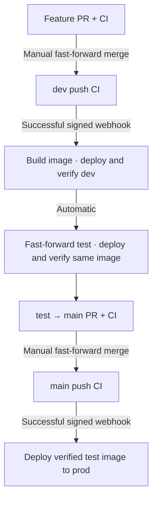

# Local CI/CD setup

Gitea hosts the application and a private deployment-control repository. Separate
repository-scoped runners execute application CI and trusted deployment jobs.
Control templates live in `infra/gitea/deply-repo/`; `make platform-install`
publishes them. GitHub is a source/publication remote, not this lab's CI engine.

## Delivery flow



These are Mermaid diagrams, rendered by GitHub's Markdown viewer. Detailed component
and sequence diagrams are in [architecture.md](architecture.md).

## Automated first installation

Run `make setup` from a clean clone on Linux or WSL2 with Docker running.
Only the administrator username and email are prompted; passwords, JWT secrets,
API credentials and runner registration tokens are generated locally.

The command prepares sample inputs, starts Gitea, creates private application and
control repositories, registers repository-scoped runners, installs the controller
and signed webhook, and seeds branches. It waits for actual CI and successful
scheduler runs in all three Airflow environments. Initial prod deployment establishes
the baseline; subsequent prod releases require the normal test-to-main PR.

Setup then configures fast-forward-only merges and protects dev/main against direct
and force pushes, requiring PR CI. Test remains writable by release automation.
No manual workflow registration, token copying or initial CI reruns are required.

Generated credentials and setup state live in ignored `secrets/`. Keep the state:
it identifies the installation and lets the same command resume without replacing
credentials or input data. Setup publishes the recorded committed source revision;
it never publishes uncommitted source files.

To inspect the generated Gitea administrator login **locally**:

```bash
cat secrets/gitea-admin-login.txt
```

Do not paste that output into issues or chat. Change the password after login.
Use `make airflow-password ENV=dev` for Airflow login.

For an isolated installation in a separate checkout:

```bash
python3 infra/cicd/provision.py --project airflow-demo --gitea-port 3100 --airflow-port 8181
```

The three Airflow ports start at the supplied port. Use the same arguments on reruns.
Existing manually configured installations use the normal platform commands;
the automated installer refuses to adopt unrelated existing containers or volumes.

## Setup progress

The terminal shows RUN, WAIT, OK and FAIL statuses, stage/total elapsed time,
and direct links to Gitea Actions runs. Waiting operations report progress every
15 seconds; no estimated completion percentage is invented. Supported interactive
terminals use status colors; redirected output and `NO_COLOR=1` use plain text.

Detailed Docker output and stage events are written to the displayed
`logs/setup/<timestamp>-<pid>.log` file (mode 600, ignored by Git).
Credential-generating command output is excluded from these logs.
A failure identifies its stage and log path; rerun the same command after fixing it.

## Setup troubleshooting

A failed setup preserves its state and prints the failing stage. Correct the cause
and rerun the same command. Inspect application/control Actions in Gitea and
`make releases` for deployment failures. Do not delete volumes or regenerate secrets
to retry. Image downloads, CI and scheduler readiness determine elapsed time;
two minutes is not a guaranteed installation duration.

## What is checked

The receiver verifies HMAC-SHA256 over the raw webhook body, then requests the run
from Gitea. Only successful **push** CI runs from the configured app repository,
`.gitea/workflows/ci.yaml`, and current dev/main SHA are eligible. PRs, other
workflows, failed runs and stale revisions cannot deploy. Inputs enter the workflow
through environment variables and are validated before Git or Docker operations.
The receiver stores dispatched run/attempt IDs in a named volume to suppress
normal webhook redelivery. A crash between dispatch and recording can produce a
repeat request; the controller serializes jobs, reuses the image and verifies again.

The controller has no PR runner registration. Its local API credential never enters
application CI jobs. This is still a trusted single-owner Docker lab: accepted
application code and control-repository writers can execute code with deployment
privileges. The repository API scope is broad; do not expose this setup publicly.
The receiver uses the Python standard library HTTP server on an internal network.
Runner APK dependencies and the receiver base image are not fully locked.

The application image contains code, SQL, DAGs and scripts. Environment settings,
input CSV files and named state volumes stay separate. The release image ID and
source label must match the deployed containers. Scheduler-driven `sales_etl`
must finish successfully, including its downstream persisted-row check.
Do not edit input files or manually trigger DAG runs during deployment. The active
run check prevents interrupting existing work but is not a distributed admission
lock against concurrent external triggers. This lab DAG is unscheduled.

## Records and recovery

The `release-data` volume stores `<sha>.json`, last verified `dev.json`, `test.json`,
`prod.json`, and separate `*-attempt.json` files. A failed or interrupted attempt
must not be mistaken for the last verified deployment. A killed process can leave
an attempt marked `deploying`; inspect containers and active DAG runs before retry.
Images and environment data are retained. Do not prune images or remove volumes.

Failed webhook dispatch appears under the application repository's **Settings →
Webhooks → delivery history**, and in receiver logs. Fix the cause, then redeliver.
A previously dispatched but failed deployment is retried with **Deployment → Run
workflow**, supplying `operation=release`, branch, full SHA and successful app CI
run ID. The branch tip and CI result are checked again. Rerunning CI also creates
a new run/attempt notification. No failed deployment advances to a later stage.

For production backout, use **Deployment → Run workflow** on control `main`:
`operation=rollback`, `branch=main`, and a full SHA previously verified in prod.
Leave CI run ID empty. This redeploys the retained image and reruns verification;
it does not move Git branches, reverse metadata migrations, or undo business data.
A missing retained image blocks backout rather than rebuilding it. Follow a runtime
backout with a reviewed source correction/revert through the normal flow.

## Stop and resume

Stop creating PRs/merges/pushes and finish or cancel active CI/deployment jobs first:

```bash
make platform-stop
```

The command checks both repositories for queued/running jobs, disables the webhook,
checks again, then stops receiver and runners before Gitea. It refuses to stop if
jobs remain. Airflow stays running, and all named volumes/images are retained.
`make platform-start` resumes the webhook. If work arrived while the hook was disabled,
rerun the relevant CI or manually dispatch after checking its SHA; there is no
background polling or automatic replay of events missed while stopped.
