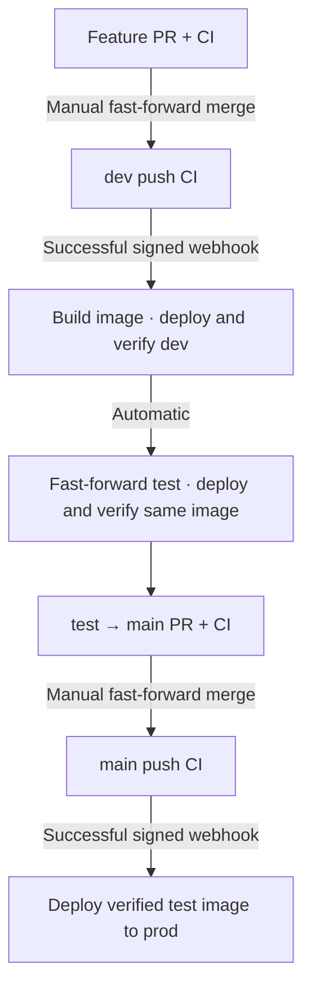

# Local CI/CD setup

Gitea hosts the application and a private deployment-control repository. Separate
repository-scoped runners execute application CI and trusted deployment jobs.
Control templates live in `infra/gitea/deply-repo/`; `make platform-install`
publishes them. GitHub is a source/publication remote, not this lab's CI engine.

## Delivery flow



These are Mermaid diagrams, rendered by GitHub's Markdown viewer. Detailed component
and sequence diagrams are in [architecture.md](architecture.md).

## 1. Prepare Airflow and start Gitea

Prepare the three input directories and JWT secret files using the
[runtime guide](airflow-runtime.md#prepare-environment-inputs-and-secrets).
Run all commands from the repository root.

```bash
make platform-bootstrap
```

Bootstrap configures SQLite without the browser installer. On a fresh installation,
it prompts for a username/email and Gitea displays a generated password locally.
Sign in at http://localhost:3000 and change that password. Repeating bootstrap
skips account creation when an administrator already exists. Self-registration
is disabled; administrators create additional users. The examples use owner `cicd`; if yours differs,
update `APP_REPO` and `CONTROL_REPO` in `environments/cicd.env`.

## 2. Create repositories and initialize branches

In Gitea create:

| Repository | Visibility | Initialization |
|---|---|---|
| `cicd/airflow-cicd-lab` | Private | Empty; source is pushed from this checkout |
| `cicd/airflow-cicd-deploy` | Private | Initialize with README, default branch `main` |

Enable **Actions** in each repository's settings if it is disabled. Add the local
application remote if this checkout does not already have it:

```bash
git remote add gitea http://localhost:3000/cicd/airflow-cicd-lab.git
```

For a **new empty application repository only**, seed all three branches from the
committed baseline containing the CI workflow:

```bash
git -c credential.helper= push gitea HEAD:refs/heads/dev HEAD:refs/heads/test HEAD:refs/heads/main
```

This bootstrap starts all branches at one revision. Subsequent changes use PRs and
automatic promotion. Do not force-push to replace existing environment history.
Set the application default branch to `dev` and use fast-forward-only merges.
Protect dev/main against direct and force pushes; require the exact CI quality
status shown by Gitea and apply protection to administrators. Permit the automation
identity to fast-forward test. Configure protection after the initial branch seed.

## 3. Register the two runners

Registration is repository-specific; do not reuse one repository's token for both.
Open **Settings → Actions → Runners → Create new Runner** in each repository.
Copy its registration token and save it at the appropriate hidden prompt:

Application repository:

```bash
(umask 077; mkdir -p secrets; read -rsp 'Application runner token: ' runner_token; printf '\n'; test -n "$runner_token" && printf '%s' "$runner_token" > secrets/cicd.runner-token)
```

Control repository:

```bash
(umask 077; mkdir -p secrets; read -rsp 'Deployment runner token: ' runner_token; printf '\n'; test -n "$runner_token" && printf '%s' "$runner_token" > secrets/cicd.deploy-runner-token)
```

Starting the services enrolls `airflow-lab-ci` in the application repository and
`airflow-lab-deploy` in the control repository. Registration persists in named
volumes. The CI runner uses its isolated Docker engine; only the deployment runner
mounts the host Docker socket. Do not register it as an instance-wide runner.

## 4. Install the controller and webhook

In **user Settings → Applications**, generate a personal API token with
**Repository: Read and Write** (`write:repository`), no site-admin scope. The
identity must be able to access both repositories, configure the app webhook,
publish control scripts and fast-forward test. Save it locally:

```bash
python3 infra/cicd/setup.py credentials
```

```bash
make platform-start
```

```bash
make platform-install
```

The installer commits/pushes the reviewed controller files to the private control
repository and creates/updates the signed CI-completion webhook. It does not
commit or push your application worktree. **No manual workflow registration or
web-editor copying is needed.** The deployment workflow is installed at
`.gitea/workflows/deploy.yaml` and its scripts at repository-root `scripts/`.

The receiver is internal-only at `http://webhook-receiver:9000/webhook`.
Both Gitea security and legacy webhook allowlists include `private:9000`; the
explicit legacy entry replaces older values retained in Gitea's configuration.
This permits private destinations on that port, not every port or every host.

The final controller reads the application using its local API token. The earlier
manual checkout exercise used **user Settings → Actions → General → Cross-Repository
Access**; that setting is not required for the installed controller's source fetch.

## 5. Verify the initial release

Confirm both runners appear **Idle** in their respective repository settings.
Rerun application **push CI on dev** if its initial completion preceded webhook
installation. Successful completion automatically dispatches Deployment. Wait for
dev and test verification, then inspect:

```bash
make releases
```

For ongoing changes, open a test → main PR, wait for CI and manually fast-forward
merge. The resulting main push CI triggers prod. On a brand-new setup where all
branches were seeded to the same baseline, there is no merge difference: after
test verification, explicitly rerun **main push CI** to authorize the initial prod
release. Use the application CI run, not a PR run or an old Deployment retry.

Open the Airflow UIs at ports 8081/8082/8083 and check `sales_etl` runs. Retrieve
login passwords with `make airflow-password ENV=dev|test|prod` (choose one value);
see [credentials](secrets.md). All verified records should identify the same source
revision and image. Inspect business rows with `make sales ENV=prod`.

## What is checked

The receiver verifies HMAC-SHA256 over the raw webhook body, then requests the run
from Gitea. Only successful **push** CI runs from the configured app repository,
`.gitea/workflows/ci.yaml`, and current dev/main SHA are eligible. PRs, other
workflows, failed runs and stale revisions cannot deploy. Inputs enter the workflow
through environment variables and are validated before Git or Docker operations.
The receiver stores dispatched run/attempt IDs in a named volume to suppress
normal webhook redelivery. A crash between dispatch and recording can produce a
repeat request; the controller serializes jobs, reuses the image and verifies again.

The controller has no PR runner registration. Its local API credential never enters
application CI jobs. This is still a trusted single-owner Docker lab: accepted
application code and control-repository writers can execute code with deployment
privileges. The repository API scope is broad; do not expose this setup publicly.
The receiver uses the Python standard library HTTP server on an internal network.
Runner APK dependencies and the receiver base image are not fully locked.

The application image contains code, SQL, DAGs and scripts. Environment settings,
input CSV files and named state volumes stay separate. The release image ID and
source label must match the deployed containers. Scheduler-driven `sales_etl`
must finish successfully, including its downstream persisted-row check.
Do not edit input files or manually trigger DAG runs during deployment. The active
run check prevents interrupting existing work but is not a distributed admission
lock against concurrent external triggers. This lab DAG is unscheduled.

## Records and recovery

The `release-data` volume stores `<sha>.json`, last verified `dev.json`, `test.json`,
`prod.json`, and separate `*-attempt.json` files. A failed or interrupted attempt
must not be mistaken for the last verified deployment. A killed process can leave
an attempt marked `deploying`; inspect containers and active DAG runs before retry.
Images and environment data are retained. Do not prune images or remove volumes.

Failed webhook dispatch appears under the application repository's **Settings →
Webhooks → delivery history**, and in receiver logs. Fix the cause, then redeliver.
A previously dispatched but failed deployment is retried with **Deployment → Run
workflow**, supplying `operation=release`, branch, full SHA and successful app CI
run ID. The branch tip and CI result are checked again. Rerunning CI also creates
a new run/attempt notification. No failed deployment advances to a later stage.

For production backout, use **Deployment → Run workflow** on control `main`:
`operation=rollback`, `branch=main`, and a full SHA previously verified in prod.
Leave CI run ID empty. This redeploys the retained image and reruns verification;
it does not move Git branches, reverse metadata migrations, or undo business data.
A missing retained image blocks backout rather than rebuilding it. Follow a runtime
backout with a reviewed source correction/revert through the normal flow.

## Stop and resume

Stop creating PRs/merges/pushes and finish or cancel active CI/deployment jobs first:

```bash
make platform-stop
```

The command checks both repositories for queued/running jobs, disables the webhook,
checks again, then stops receiver and runners before Gitea. It refuses to stop if
jobs remain. Airflow stays running, and all named volumes/images are retained.
`make platform-start` resumes the webhook. If work arrived while the hook was disabled,
rerun the relevant CI or manually dispatch after checking its SHA; there is no
background polling or automatic replay of events missed while stopped.
